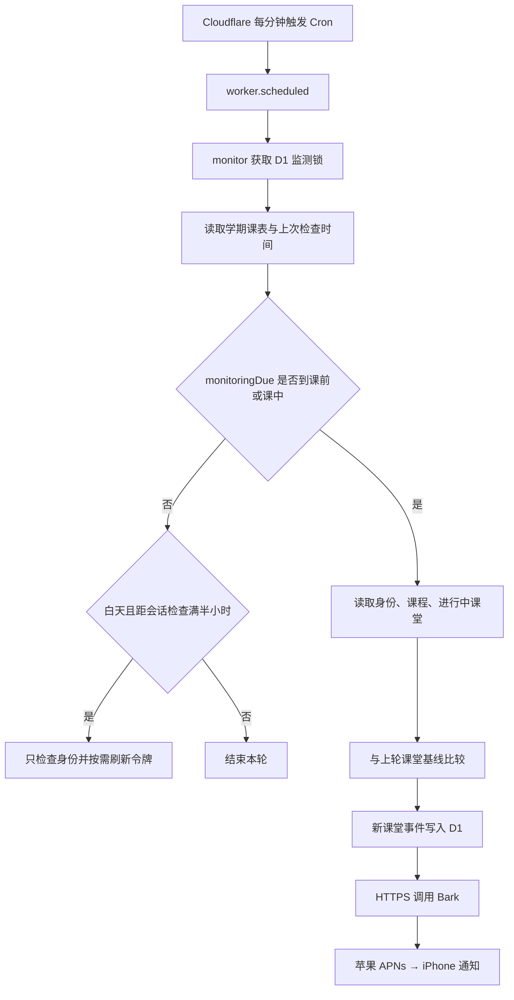

# 实现流程与源码导读

基于 2026-11-13 当前本地源码整理。主要阅读对象是已部署的 Cloudflare 版本；Chrome 扩展和本地中转原型也保留在仓库中。

用户最新明确选择：开启检测并尝试自动签到。当前 `ENABLE_ATTENDANCE_MONITOR=true`、`ENABLE_SIGNING=true`、`AUTO_SIGN=true`、`SIGNING_PROTOCOL=plugin`；独立采样关闭。默认处理无需手机点击，后文的手机确认流程仍是可选模式。原插件兼容模式与自动分支见 [自动模式说明](AUTOMATIC_SIGNING.md)。

## 1. 当前实现到哪一步

| 功能 | 当前状态 |
|---|---|
| Workers + D1 部署、Cron 调度 | 已部署，运行不依赖 Mac |
| 云邮令牌续期 | 一次真实云端刷新成功，新令牌已用于后续只读查询 |
| 学期课表 | 从已登录教务页面一次读取，展开为 172 个有具体日期的时段 |
| 课堂监测 | 已启用，07:00–21:00，课前十分钟至下课每分钟查询 |
| 课外会话维护 | 每半小时检查本人身份并按需续期，不扫描课程与课堂 |
| Bark 推送 | 云端测试已送达本人 iPhone |
| 签到检测与提交 | 按用户最新要求开启原插件兼容自动试运行；真实结果以状态和到课记录为准 |
| 签到基础查询只读采样 | 代码已具备，当前按用户要求关闭，`ENABLE_ATTENDANCE_PROBE=false` |
| 每日自动同步教务调课 | 尚未实现；当前使用整学期快照，变化后需重新导入 |
| 手机通知送达回执、独立掉线监控 | 尚未实现 |

已记录 49 项模拟测试通过；模拟通过与真实课堂签到验证是两种证据，不将已部署自动模式当作已经完成真实签到。

## 2. 目录和职责

```text
ucloud-check/
├── README.md                       总入口、当前状态和常用命令
├── docs/                           本导读、配置说明和部署记录
├── cloudflare/
│   ├── worker.mjs                  云端入口、接口、监测、事件、确认及执行
│   ├── session.mjs                 登录客户端选择、刷新、轮换令牌加密存取
│   ├── schedule.mjs                白天时段与本轮是否需要查询的判断
│   ├── timetable.mjs               周次、星期、节次 → 实际日期窗口
│   ├── import-timetable.mjs        本地课表转换后上传至云端
│   ├── wrangler.toml               部署、D1、静态页面、Cron 与功能开关
│   ├── migrations/0001.sql         events、state、leases 三张表
│   ├── init.mjs                    首次生成本地空白配置及随机服务密钥
│   ├── test-bark.mjs               本机向 Bark 发真实测试通知
│   ├── .dev.vars.example           配置模板
│   ├── .dev.vars                   本地私密配置，Git 忽略
│   └── timetable.local.json        本人学期课表规则，Git 忽略
├── public/monitor/core.js          ID、时间、签到状态、事件键等公共校验
├── relay/web/                      云端与本地共用的手机确认 HTML/CSS/JS
├── relay/server.mjs                本地 Node 中转服务
├── public/background.js            Chrome 扩展后台监测路径
├── src/                            Chrome 扩展弹窗、设置及会话同步
└── tests/                          协议、云端、课表、调度与本地原型测试
```

云端直接复用 `relay/web/` 页面，因此该目录也是当前生产部署的依赖。`public/monitor/core.js` 同样被云端导入。

## 3. 先看这条调用链



Cron 每分钟唤醒，并不表示每分钟都调用学校接口。夜间仍会进入调度函数、做少量 D1 操作，时间判断后结束；夜间不自动访问云邮。

建议按以下位置阅读：

| 文件和函数 | 看什么 |
|---|---|
| `cloudflare/wrangler.toml` 的 `[triggers]`、`[vars]` | 每分钟 Cron、07:00–21:00、课前十分钟、功能开关 |
| `cloudflare/worker.mjs` 的 `scheduled()` | Cloudflare 调用的入口，执行 `monitor(env, { scheduled: true })` |
| `cloudflare/worker.mjs` 的 `monitor()` | 获取锁、读取课表、分流到会话维护或课堂查询 |
| `cloudflare/schedule.mjs` 的 `monitoringDue()` | 具体时间和频率算法 |
| `cloudflare/worker.mjs` 的 `api()`、`courses()` | 请求学校接口与处理真实无课堂响应 |
| `cloudflare/worker.mjs` 的 `createEvent()`、`notify()` | 去重、持久化以及发送 Bark |

## 4. 整学期课表怎么变成检测时间

本次通过已登录浏览器读取教务“学期理论课表”的“全部周次”视图，并在首页第 1 周核对周一是 `2026-08-31`。并未把教务 Cookie 或统一认证密码复制到服务器。

本地 `cloudflare/timetable.local.json` 保存学期、第一周周一、14 节作息时间和 30 条周次规则。`expandTimetable()` 处理：

1. 展开 `3-11,13-18` 这类间断周。
2. 用星期确定该周日期。
3. 用节次映射开始、结束时刻，明确采用 `+08:00`。
4. 将课表中重复显示在多个格子的同一课程去重。
5. 保留临时换课所在的周次、星期和节次；不把普通周的安排硬套到调课周。

例如，面向对象课程平常安排在周二，第 12 周另排在周三第 6–7 节。当前导入数据分别保存这两条规则。

运行 `pnpm cf:import-timetable` 后，`import-timetable.mjs` 转换规则，鉴权调用 `POST /api/admin/timetable`。云端验证起止时间、查询当前云邮身份，将课表绑定账号并写入 D1 的 `state.timetable`。

`CLASS_WINDOWS` 环境变量是旧的手工窗口入口；导入 D1 课表后，监测优先使用 D1 中的数据。当前无需将 172 条窗口塞进部署配置。

课表中的无节次课程不能生成准确窗口。调课发生变化或进入新学期后，应重新读取页面、更新本地规则并导入。当前导入命令只上传已有文件，不会自行登录教务取新课表。

## 5. 定时检测如何决定是否请求学校

`monitoringDue(env, now, lastAttempt, activeUntil)` 是纯函数：

1. 检查监测总开关。
2. 将时间换算为北京时间，07:00 前或 21:00 起直接返回 false。
3. 检查是否处于某个课前十分钟至下课的窗口。
4. 已发现进行中课堂时，`active-until` 会短暂保留密集检测资格；课堂持续开启时续长。
5. 窗口内或课堂进行中，每满一分钟返回 true。
6. 已导入课表时，课外不扫描课堂；未导入课表时，才使用原半小时课堂扫描作为兜底。

课外的身份检查由 `monitor()` 单独分流，每半小时最多进行一轮。直接调用管理接口 `/api/admin/monitor` 属于手动验证，会跳过定时频率判断；它仍受监测总开关控制。

## 6. 登录为什么能续期

`api()` 发送学校请求前，先调用 `session.token()`：

```text
读取 D1 加密会话
  ├─ 初次没有会话 → 使用 Cloudflare Secrets 中的初始令牌
  ├─ 已有最新会话 → 解密并使用最新 access token
  └─ 已知过期时间距当前不足两分钟 → refresh()

只读接口返回 HTTP 401
  → refresh() 一次
  → 用新令牌重新发起一次只读请求
```

`refresh()` 的实际步骤：

1. 获取 D1 的 `session` 锁，防止并发刷新。
2. 重新读取最新会话；如果其他调用已经换过令牌，复用新的值。
3. 先加密记录“正在刷新”，再向学校发送刷新请求。
4. 根据 `portal` 或 `sword` 选择前端对应的固定 Basic 客户端标识。本人的真实会话来自 `portal`。
5. 接口为 `/ykt-basics/oauth/token`，请求为表单 `grant_type=refresh_token`。
6. 返回成功后，一起保存新 access token、refresh token 和 `expires_in` 推算的过期时间。

会话使用 AES-GCM 加密后写入 D1，`SESSION_SECRET` 保存在 Cloudflare Secrets。初始配置的指纹用于识别人工换过的登录种子；未更改种子时，旧环境变量不会覆盖新令牌。

如果刷新响应丢失或被拒绝，会话保持阻断状态，避免持续重用可能已轮换的旧 refresh token，需要重新登录后更新。请求刷新令牌不能保证突破平台设置的登录总时限。

## 7. 怎么识别新课堂并发送 Bark

`monitor()` 依次请求：

| 接口 | 作用 |
|---|---|
| `GET /ykt-basics/info` | 确认本人身份 |
| `GET /ykt-site/site/list/student/current` | 读取当前课程列表 |
| `POST /blade-chat/web/chat/myCourse` | 查询这些课程是否已开启课堂；这是查询接口 |

真实平台在没有课堂时返回 `data={}` 和明确的“没有正在上课的课程”提示，`courses()` 已适配这个组合。其他未知结构继续报错。

第一次监测建立课堂基线，不把已有课堂当作新开启重复提醒。之后新增的课堂写入 `events`，事件键包含账号、课程、课次和事件类型。`notify()` 通过 D1 条件更新领取推送任务，再向 `https://api.day.app/push` 发送 JSON，包含设备 key、标题、正文和分组。

Bark 请求被接受后记录已推送；失败则释放领取标记，活动仍有效且再次被扫描时可以重试。当前没有独立的无限重试队列，也没有手机送达回执。Bark 接受与手机实际显示通知需要区分。

## 8. 手机确认和签到代码在哪里

**当前按用户最新要求开启自动模式。** `ENABLE_ATTENDANCE_MONITOR` 控制检测，`ENABLE_SIGNING` 控制提交，`AUTO_SIGN=true` 时自动将有效候选交给执行器；`AUTO_SIGN=false` 时保留手机确认。`SIGNING_PROTOCOL=plugin` 使用原插件的正数 ID 判定，空的状态校准变量不会阻断此兼容模式；原有严格校准协议仍可选择。独立采样当前关闭。原插件对应位置见 [原插件对照](PLUGIN_SIGNING_COMPARISON.md)。

校准并启用后，调用链为：

```text
attendance() 查询有效活动及本人未签到状态
  → createEvent() 保存 pending 事件
  → notify() 发送带确认链接的 Bark
  → 手机打开 relay/web/index.html
  → app.js 请求 view，显示活动（打开页面不提交）
  → 用户点击确认，POST confirmation/confirm
  → D1 原子状态更新 pending → confirmed
  → execute() 原子领取 confirmed → processing
  → 重查账号、课堂、活动、本人的状态和有效期
  → 读取动态 clock 参数
  → 向学校提交一次签到请求
  → 保存 done 和结果，再发送结果通知
```

确认链接使用 `事件 ID + HMAC 签名`，放在 URL 片段中。手机页面读取片段后清除地址栏中的片段；页面轮询与按钮请求携带本轮凭证，不使用学校 token。

确认有效期最长五分钟，且不超过学校活动的截止时间。学校返回业务成功只记录 `accepted`，表示请求被接受，并非已经独立核查到课记录。写请求超时或状态未知时记录 `unknown`，不会盲目重复提交；响应为 401 时也不自动重发签到写请求。

原插件兼容模式已按源码采用 `groupId → classLessonId`。已知的过期、未来活动、课程或课次不匹配会被拒绝；未提供时间时使用本地最长五分钟的处理窗口，是否接受由学校接口决定。自动模式直接领取候选并执行，不经过上面的手机按钮；已存在同轮到课或请假记录则跳过。完整规则见自动模式说明。

## 9. D1 三张表分别做什么

| 表 | 主要内容 |
|---|---|
| `state` | AES-GCM 会话密文、学期课表、课堂基线、上次检查时间、运行状态 |
| `leases` | `monitor` 和 `session` 的短期互斥锁 |
| `events` | 课堂/签到活动、有效期、执行状态、推送状态和处理结果 |

Worker 实例退出后，状态保留在 D1。不能依赖进程内变量记住最新令牌或已处理事件。

## 10. 管理接口与实际操作效果

以下均为 `POST`，需要 `Authorization: Bearer ADMIN_KEY`；服务不会在响应中返回学校令牌或 Bark key。

| 路径 | 效果 |
|---|---|
| `/api/admin/status` | 查看监测、最近登录检查及课表摘要 |
| `/api/admin/monitor` | 立即安排一轮监测，跳过定时频率判断 |
| `/api/admin/timetable` | 验证并替换云端学期课表 |
| `/api/admin/refresh-session` | 实际刷新一次会话，并核对刷新前后账号 |
| `/api/admin/test-bark` | 向本人的手机发送真实测试通知 |

`GET /health` 是公开的基础健康检查；只证明服务能响应，不证明最新学校查询成功或手机已收到通知。

## 11. 如何核对实现

先在仓库根目录运行 `pnpm test`。当前测试使用模拟学校/Bark、内存 SQLite 和本地回环服务，不使用真实学校凭据。

| 测试文件 | 重点 |
|---|---|
| `tests/schedule.test.mjs` | 时段边界、课前窗口、课外停止扫描 |
| `tests/timetable.test.mjs` | 间断周、调课、重复格、节次与日期展开 |
| `tests/cloudflare.test.mjs` | 续期、客户端、加密保存、调度、导入鉴权、确认去重与未知结果 |
| `tests/core.test.mjs` | 长 ID、有效期、活动归属、个人状态等协议校验 |
| `tests/worker.test.mjs` | Chrome 扩展后台流程，模拟浏览器环境 |
| `tests/relay.test.mjs` | 本地中转的确认、过期、恢复与推送失败 |

部署记录中的真实测试和上述模拟测试分开阅读。配置、导入、发测试通知以及部署命令的效果可从根目录 README 和 `package.json` 核对。

## 源码快捷入口

| 环节 | 本机文件位置 |
|---|---|
| 定时入口 | [cloudflare/worker.mjs:300](/Users/tuoji/Documents/ChatGPT/REA/ucloud-check/cloudflare/worker.mjs:300) |
| 主监测函数 | [cloudflare/worker.mjs:158](/Users/tuoji/Documents/ChatGPT/REA/ucloud-check/cloudflare/worker.mjs:158) |
| 频率判断 | [cloudflare/schedule.mjs:3](/Users/tuoji/Documents/ChatGPT/REA/ucloud-check/cloudflare/schedule.mjs:3) |
| 课表展开 | [cloudflare/timetable.mjs:2](/Users/tuoji/Documents/ChatGPT/REA/ucloud-check/cloudflare/timetable.mjs:2) |
| 登录会话 | [cloudflare/session.mjs:18](/Users/tuoji/Documents/ChatGPT/REA/ucloud-check/cloudflare/session.mjs:18) |
| 学校接口封装 | [cloudflare/worker.mjs:44](/Users/tuoji/Documents/ChatGPT/REA/ucloud-check/cloudflare/worker.mjs:44) |
| Bark 请求 | [cloudflare/worker.mjs:70](/Users/tuoji/Documents/ChatGPT/REA/ucloud-check/cloudflare/worker.mjs:70) |
| 事件去重 | [cloudflare/worker.mjs:110](/Users/tuoji/Documents/ChatGPT/REA/ucloud-check/cloudflare/worker.mjs:110) |
| 确认后执行 | [cloudflare/worker.mjs:131](/Users/tuoji/Documents/ChatGPT/REA/ucloud-check/cloudflare/worker.mjs:131) |
| 手机确认页面 | [relay/web/app.js:15](/Users/tuoji/Documents/ChatGPT/REA/ucloud-check/relay/web/app.js:15) |
| 数据库结构 | [cloudflare/migrations/0001.sql:1](/Users/tuoji/Documents/ChatGPT/REA/ucloud-check/cloudflare/migrations/0001.sql:1) |
